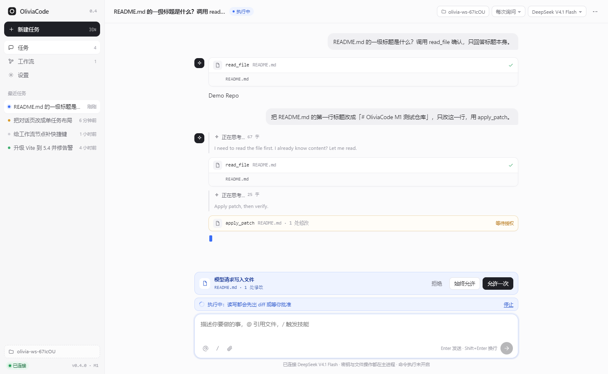
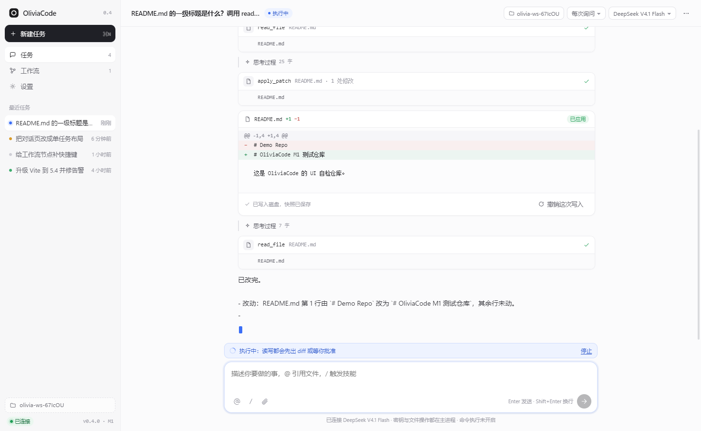
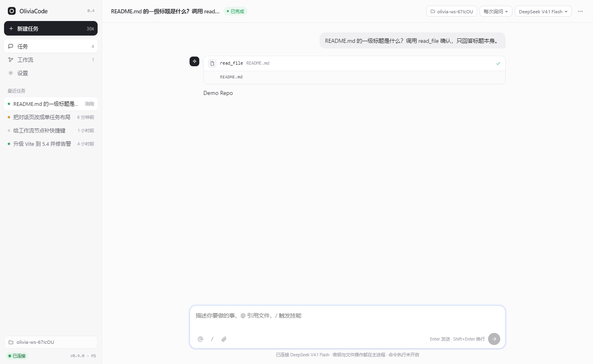
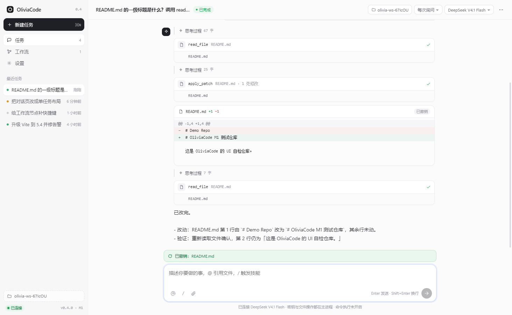

# OliviaCode

本地优先的 AI 编程工作站。外观与交互贴近 Codex，但多了四件它不给的事：**可视化工作流、可回滚执行、Git 直连、定时无人值守**。

当前是 **M1：真实工具闭环**——模型能读你的仓库、改文件、跑命令，改之前出 diff，写入前自动快照，点一下就能撤销。

<p align="center">
  
  
</p>

## M1 里已经能用的东西

- **真实工具调用**：`list_dir`、`read_file`、`search`、`apply_patch`、`write_file`、`run_command`、`git_status`、`git_diff`。走 OpenAI 原生 `tools` / `tool_calls`。
- **逐次审批**：写文件与跑命令默认弹审批条（允许一次 / 始终允许 / 拒绝），「始终允许」写进工作区的 `.olivia/policy.json`，可以提交、可以审。
- **快照与撤销**：每次写入前把文件原样存进应用数据目录，diff 卡片上有「撤销这次写入」，独立于 Git，不碰你的提交历史。
- **命令执行默认关闭**：设置里有一次「我明白风险」确认，开启后仍按审批策略逐条询问。
- **事件日志**：每个任务一份 JSONL，重启后从日志重放消息、工具记录与 diff。
- **主进程隔离**：密钥与文件系统都在主进程，渲染层通过 IPC 拿事件，拿不到 `fs`。

<p align="center">
  
  
</p>

## 快速开始

```bash
npm install          # 首次装 electron 若卡住：ELECTRON_MIRROR=https://npmmirror.com/mirrors/electron/
npm start            # 构建前端 + 主进程，然后启动桌面端
```

其他脚本：

```bash
npm run dev:web        # 只跑前端，浏览器访问 http://127.0.0.1:5273
npm run typecheck      # 前端 + 主进程严格检查
npm run shot           # 截图到 docs/screenshots
```

## 接自己的模型

客户端只认 OpenAI 兼容协议，两种接法：

1. 应用内「设置 → 模型接入」填 Base URL 与 API Key（只存本次会话内存）；
2. 环境变量预置（经 IPC 注入，不落盘）：

```powershell
$env:OLIVIA_BASE_URL='http://127.0.0.1:9088/v1'
$env:OLIVIA_API_KEY='sk-...'
$env:OLIVIA_MODEL='deepseek-v4.1-flash'
$env:OLIVIA_WORKSPACE='D:\your\repo'   # 可选，预置工作区，省掉选目录
npm start
```

模型目录与 `GET /models` 对齐：`deepseek-v4.1-flash`、`qwen3.8-27b`。

## 自检

两条不依赖人眼的验收脚本：

```bash
# 纯 agent 层：读 → 改 → 撤销 → 跑命令 → 事件日志（5 条断言）
node apps/desktop/dist/selftest.cjs

# 界面层：无头驱动真实窗口走完同样流程并截图
electron scripts/ui-e2e.cjs
```

两者都需要 `OLIVIA_BASE_URL` / `OLIVIA_API_KEY`。

## 目录结构

```
apps/
  desktop/          Electron 主进程：agent 循环、工具执行、快照、事件日志
    src/main.ts       IPC、窗口、任务日志、撤销
    src/agent.ts      模型流式 + 工具编排 + 审批
    src/sessions.ts   JSONL 追加写
    src/workspace.ts  工作区校验与 .olivia/policy.json
    src/preload.ts    contextBridge 暴露的最小面
  web/              React + Vite 渲染层
    src/views/        Chat / Workflow / Settings
    src/components/   消息流、工具卡、diff 卡、审批条
    src/store.tsx     任务状态 + 事件重放
packages/
  core/             工具契约、事件类型、diff、工作流模型（纯函数，双端共用）
  exec/             执行器：路径围栏、三档权限、命令、快照存储
scripts/            截图与 UI 自检
```

## 四个已经定下来的设计决定

1. **主进程持有能力，渲染层只有视图**：模型调用、`fs`、命令、密钥都在主进程；渲染层只发意图、收事件。
2. **工具契约化**：每个工具声明 `name / schema / risk`，渲染层按 schema 画卡片，不认识具体工具。加工具＝加一个 case。
3. **权限三层 + 规则**：只读 / 工作区可写 / 全部放行，读工具自动放行，写与命令逐条询问；「始终允许」沉淀成项目里的规则文件。
4. **快照独立于 Git**：写入前按原样存档，撤销就是还原，不与用户的分支、暂存区纠缠。

## 路线图

| 阶段 | 内容 | 状态 |
| --- | --- | --- |
| M0 | 骨架、Codex 式外壳、工作流画布、真模型直连 | ✅ |
| M1 | 主进程 agent 循环、8 个工具、审批、快照撤销、事件日志 | ✅ 本次 |
| M2 | 多步回滚、逐 hunk 接受、上下文预算与检索优化 | 下一步 |
| M3 | Git 可视化：绑定仓库、克隆/拉/推/PR | 计划 |
| M4 | 多智能体并行与工作流真实执行 | 计划 |
| M5 | 定时任务（无人值守，出报告或提 PR） | 计划 |
| M6 | MCP 接入与团队技能 | 计划 |
| M7 | 成本与上下文面板、内置浏览器预览 | 计划 |

## 已知限制

- 工作流画布仍是编辑与模拟执行，节点还没真正派发 Agent（M4）。
- 撤销只支持「最近一次写入」（M2 做多步）。
- 命令以参数数组启动、不经过 shell，因此管道与重定向需要显式写 `cmd /c`（Windows）或 `sh -c`。
- diff 是行级 LCS，超大文件会退化成整段替换。

## 许可

MIT
