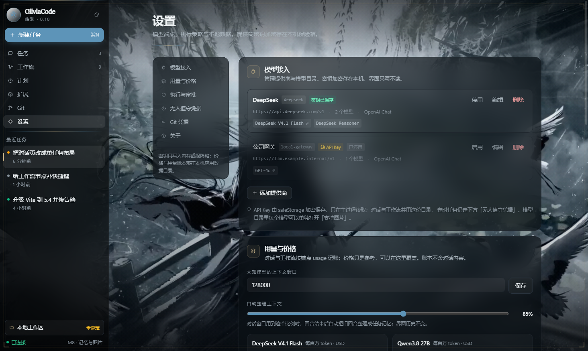
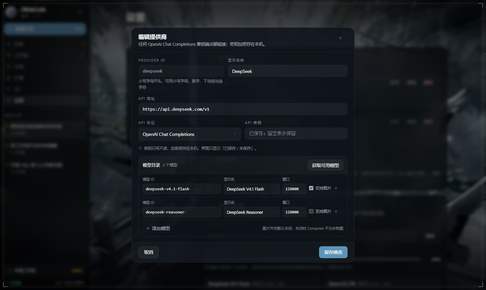
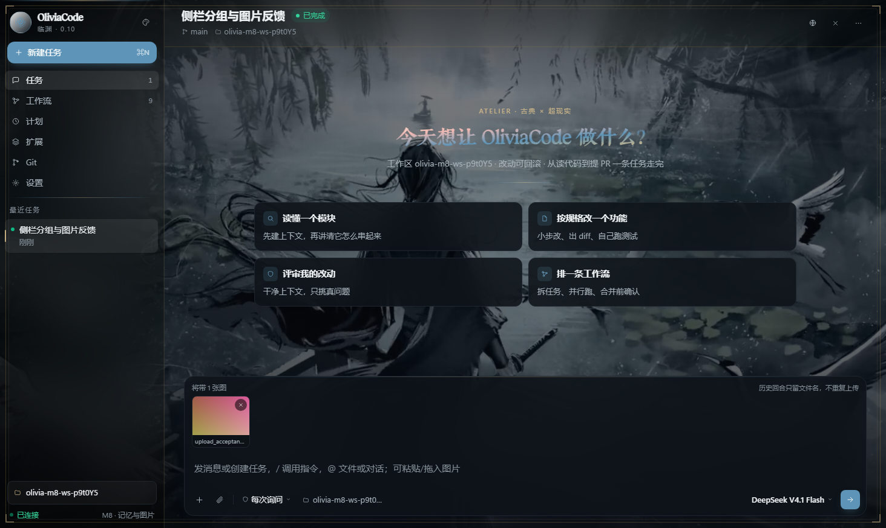
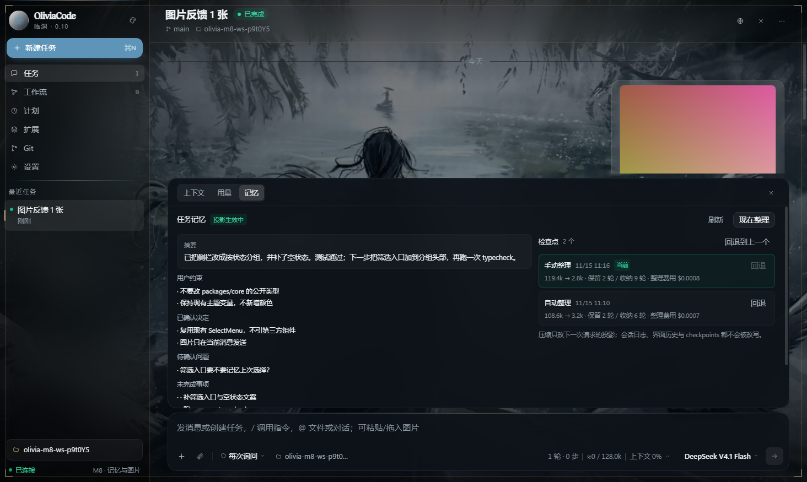
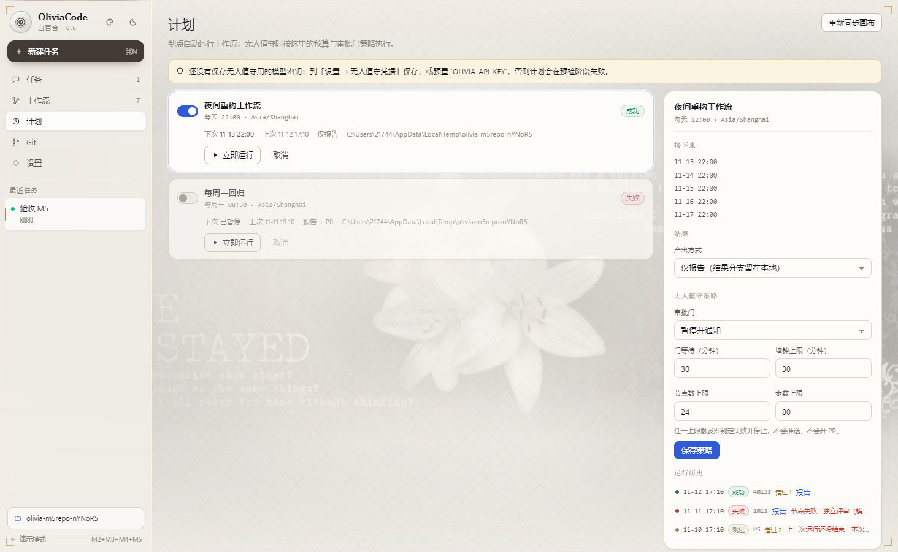
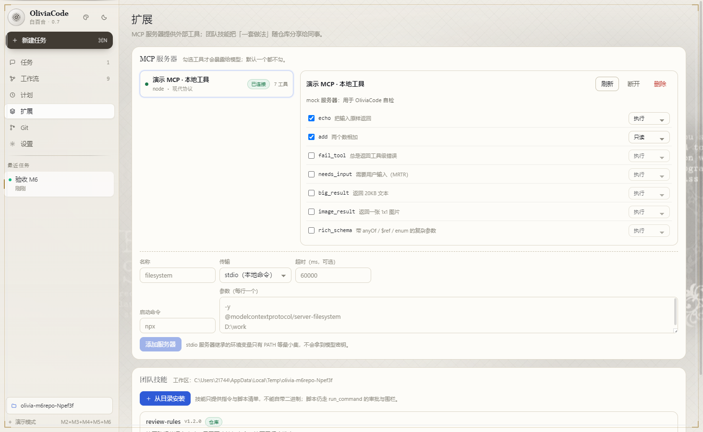
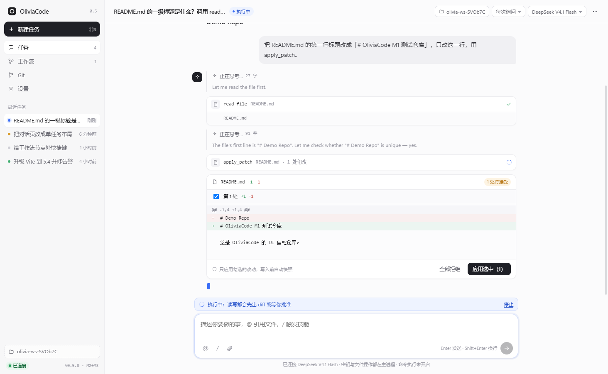
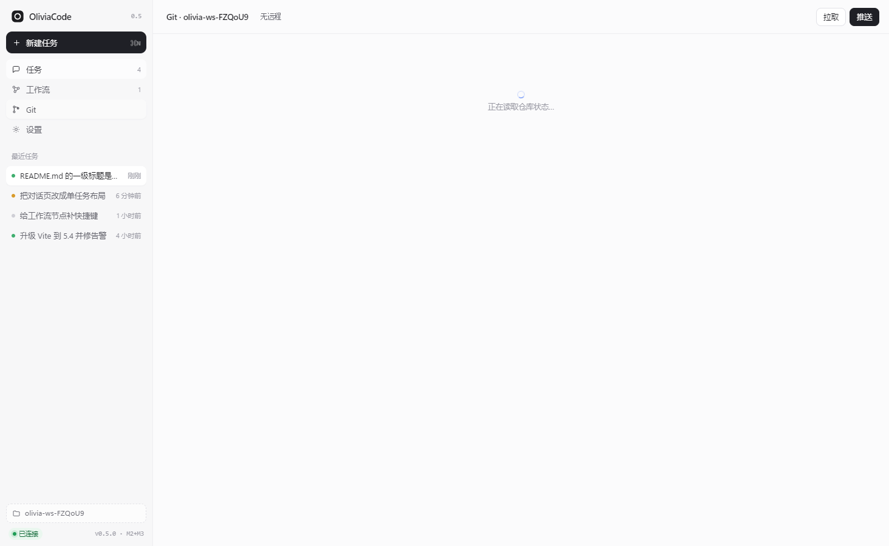

# OliviaCode

本地优先的 AI 编程工作站。外观与交互贴近 Codex，但多了几件它不给的事：**可视化工作流、逐处接受的改动、多步回滚、Git 直连**。

当前是 **M8：任务记忆与图片输入**——长任务到阈值会把旧回合整理成可核对、可回退的任务记忆，
下一次请求改用「记忆 + 最近两轮」；Composer 支持粘贴/拖入/选择图片，图片先落 artifacts，
再随当前消息以 OpenAI content parts 发给开了视觉的模型。同一版还把「模型接入」改成了
多提供商 + 模型目录：每个提供商有 ID、显示名、API 地址、协议、加密保存的密钥和可获取/手动添加的模型。
此前 M7 的用量面板与内置预览、M6.5 的动态主题、M6 的 MCP 与团队技能、M5 的定时任务都在，
见 [docs/M8.md](docs/M8.md)、[docs/M7.md](docs/M7.md)、[docs/theme.md](docs/theme.md)。

<p align="center">
  
  
</p>
<p align="center">
  
  
</p>

## 能用的东西

- **真实工具调用**：`list_dir`、`read_file`、`search`、`apply_patch`、`write_file`、`run_command`、`git_status`、`git_diff`、`git_commit`、`git_push`、`git_create_pr`。走 OpenAI 原生 `tools` / `tool_calls`。
- **逐处接受**：一次补丁里有几处修改就几个勾选框，可以只应用其中一部分；`old` 不唯一就报错让模型重读，绝不模糊套用。
- **多步回滚**：每次写入前自动快照，卡片上「回滚到这一步之前」，快照带撤销标记，可以一路退回，并提示还能退几步。
- **Git 面板**：克隆或绑定已有仓库、看分支/领先落后、逐 hunk 暂存、提交、分支切换、拉取（ff-only）、推送、创建 PR。
- **一体化输入框**：模型、权限、项目位置、发送/停止都在框内，底部显示轮次、步数、估算 token 与上下文占用。
- **令牌保险箱**：GitHub / GitCode 令牌用 `safeStorage` 加密存在本机，界面只写不读，一键清除；不写进 `.git/config`。
- **审批**：写文件与跑命令默认逐次询问；「始终允许」落进工作区 `.olivia/policy.json`，可提交、可审。
- **主进程隔离**：模型调用、`fs`、命令、令牌都在主进程，渲染层只发意图、收事件。
- **事件日志**：每个任务一份 JSONL，重启后重放消息、工具记录与 diff。
- **锦鲤主题（M7）**：两套互为正负片的主题——黑鱼白水 / 白鱼黑水。背景是离屏 canvas 画的字符锦鲤，正文区压在「阅读带」里当水印，侧栏空白带保持全强度；切换主题时金线、卡片、玻璃衬底一起换，点击任意处有水纹。字体随包分发 Inter 变量字体与 HarmonyOS Sans SC，正文与表单不依赖系统字体。
- **工作流真实执行**：按 DAG 调度节点，agent 各开一个 git worktree 并行干活，完成后串行合并成 `olivia/wf-*` 结果分支；reviewer 在只读副本上独立评审；审批门、取消、节点级工具白名单、运行日志都在界面里。
- **定时任务（M5）**：工作流到点自动跑，无人值守也能出结果。计划从画布上的「定时触发器」派生，主进程常驻调度；单次运行有墙钟/节点数/步数三重预算，审批门按策略（暂停并通知 / 自动批准 / 自动拒绝）处理，超限即失败关闭；每次运行落一份 Markdown 报告，按计划可选推送结果分支并开 PR。
- **MCP 接入（M6）**：接 stdio 与 Streamable HTTP 两种传输，现代协议（`2026-07-28`，`server/discover`）与传统协议（`initialize`）双时代兼容；工具以 `mcp__<server>__<tool>` 暴露，JSON Schema 自动降级，默认按最高风险审批；只勾选的工具才会进模型上下文。
- **团队技能（M6）**：一份 `SKILL.md` + 可选清单就能把「一套做法」随仓库提交；系统提示只放名字与一句话，模型调 `use_skill` 才加载全文（渐进式披露）。技能不能扩权，脚本仍走 `run_command` 的围栏与审批；文件被改动会自动停用并等待重新确认。示例见 `examples/skills/review-rules/`，可在「扩展」页直接装。
- **上下文与用量面板（M7）**：每次模型调用记输入/输出/缓存命中与耗时；输入框右侧一行统计点开抽屉，能看到上下文六类构成（系统提示 / 技能目录 / 历史 / 本轮 / 工具结果 / 工具定义）、窗口余量与逐步用量。端点给真实 `usage` 就用真实值，不给才估算并标 `≈`。
- **参考费用与预算（M7）**：按模型参考价算本轮/本任务/近 7 天费用（美元，可在设置逐项覆盖，不写账本、不算账单）；无人值守新增 token 硬上限（默认 100 万）与可选费用上限，超限在模型调用边界失败关闭，报告写明原因。
- **内置浏览器预览（M7）**：命令输出里出现 `http://localhost:5173` 时，工具卡上会多一个「在预览中打开」；右侧抽屉里能来回跳、切设备宽度、缩放、截图，地址栏默认只放行 loopback，外站需一次确认。预览是独立的 `WebContentsView` 会话，权限与下载一律拒绝，模型也拿不到浏览器工具。
- **artifact 预览（M7）**：MCP 工具返回的图片/音频在聊天卡里显示缩略图，点开浮层查看；只走 `olivia-artifact://` 白名单协议（realpath 校验、25MB 上限、脚本不执行）。
- **多提供商与模型目录（M8）**：设置里可以建多个 OpenAI Chat Completions 兼容端点，每个有 Provider ID、显示名、API 地址、协议、加密保存的密钥和模型目录；「获取可用模型」从 `GET /models` 读取，也可以手动添加。Composer 的模型菜单按提供商列出模型，对话、工作流与记忆整理共用；密钥只在主进程读取。
- **任务记忆与上下文压缩（M8）**：用量到设置阈值（默认 85%）自动整理，面板里也能「现在整理」；记忆分摘要、用户约束、已确认决定、未完成事项、涉及文件与待确认问题，约束/决定合并而不是重写。下一次请求改用「记忆 + 最近两轮原文」，会话日志与界面历史不改写；检查点可查看、可回退。回合内超过 70% 先缩短旧工具结果，95% 只留最近两步，仍装不下就明确失败。
- **图片输入（M8）**：Composer 支持粘贴、拖入或选择 PNG/JPEG/WebP；主进程校验、缩到最长边 1600、重编码去 EXIF 后落 artifacts，按模型「支持图片」开关决定能否附图。当前消息以 `image_url` data URL 发送，历史图片只留文件名引用；预览截图「发给模型」与 Artifact 浮层「加入输入」都只进托盘，不自动发送。
- **离线自检**：`scripts/mock-llm.cjs` 与 `scripts/mock-mcp.cjs` 顶替模型端点与 MCP 服务器，工作流并行/隔离/合并/审批门、M5 调度语义、M6 的 MCP 双时代与技能安装、M7 的 usage 四种模式、M8 的视觉 content parts / 记忆投影 / 自动整理与真实主进程 e2e 全部可以离线跑通。

<p align="center">
  
  
</p>

<p align="center">
  
  
</p>

## 快速开始

```bash
npm install          # 首次装 electron 若卡住：ELECTRON_MIRROR=https://npmmirror.com/mirrors/electron/
npm start            # 构建前端 + 主进程，然后启动桌面端
```

其他脚本：

```bash
npm run dev:web        # 只跑前端，浏览器访问 http://127.0.0.1:5273
npm run dev:desktop    # 开发桌面端：自动拉起 Vite，就绪后启动 Electron（改完刷新即可）
npm run typecheck      # 前端 + 主进程严格检查
npm run shot:pages     # 五张页面截图（两套主题的工作流/计划/对话/扩展/Git），不需要模型
npm test               # 构建主进程 + 跑十套离线自检（含新增的契约自检）
npm run test:exec      # 执行层：路径围栏（含链接逃逸）、大文件、快照撤销语义
npm run test:wf        # 工作流：并行、worktree 隔离、合并、审批门、环检测
npm run test:sched     # 定时任务：虚拟时钟下的触发、补跑、重叠、预算、门禁、报告
npm run test:mcp       # MCP：命名/降级、双时代握手、HTTP+SSE、超时、崩溃、风险放行
npm run test:skill     # 技能：解析、安装与 lock、篡改降级、启用/停用、加载
npm run test:usage     # 用量：估算、上下文归一、成本、地址策略、mock usage 四模式、agent 记账、M8 图片/记忆
npm run test:memory    # 记忆：schema 校验、合并、检查点、回退、记忆/图片上下文计数
npm run test:provider  # 提供商：校验、模型目录、持久化、/models 与连接测试
npm run test:guards    # 契约：seed 必须过校验器、计划派生不重复、diff 头格式、报错人话化
npm run test:vision    # 视觉：mock 接受 content parts；未开启视觉时拒绝图片
npm run smoke:ui       # 界面冒烟：无头加载打包页面，断言文案/结构（先 build:web）
npm run e2e:m8         # 真实主进程 e2e：提供商+密钥→图片→turn.start→日志→手动整理
npm run e2e:wf         # 真实 Electron 里跑一遍工作流并截图（用 mock 模型）
npm run e2e:preview    # 真实 WebContentsView 预览：导航、外站挂起、协议拒绝、关闭销毁
```

> Electron 相关脚本统一经 `scripts/electron-run.cjs` 调起：若宿主流环境设置了
> `ELECTRON_RUN_AS_NODE=1`，`electron` 会退化成纯 Node 模式（`app` 为 undefined），
> 垫片会清掉该变量再启动真正的 Electron。

外观相关的细节（皮肤定义、布局、截图脚本踩过的坑）见 [docs/theme.md](docs/theme.md)，工作流实现见 [docs/M4.md](docs/M4.md)。

## 接自己的模型

客户端只认 OpenAI Chat Completions 兼容协议。推荐在应用内「设置 → 模型接入」里管理：

1. 点「添加提供商」，填 Provider ID、显示名称、API 地址（如 `https://api.example.com/v1`）、
   协议与 API Key；
2. 在「模型目录」里点「获取可用模型」从 `GET /models` 读取，或手动添加模型 ID、显示名、
   窗口，并按需打开「支持图片」；
3. 保存后到 Composer 的模型菜单里选它。密钥用 `safeStorage` 加密存在本机，界面只显示是否已保存。

也仍然支持环境变量预置（经 IPC 注入，不落盘）；没有提供商保存过 Key 时会继续走这条旧路径：

```powershell
$env:OLIVIA_BASE_URL='http://127.0.0.1:9088/v1'
$env:OLIVIA_API_KEY='sk-...'
$env:OLIVIA_MODEL='deepseek-v4.1-flash'
$env:OLIVIA_WORKSPACE='D:\your\repo'   # 可选，预置工作区
npm start
```

提供商与模型目录存在 `<userData>/providers.json`，不含明文 Key；记忆检查点在
`<userData>/memory/<taskId>.json`，图片附件在 `<userData>/artifacts/`。

## Git 令牌

到「设置 → Git 凭据」分别保存 GitHub / GitCode 的访问令牌：

- GitHub：Personal Access Token，勾 `repo` 权限即可。
- GitCode：个人访问令牌，需要仓库写权限。
- 只做推送与 PR，克隆走 HTTPS。

## 自检

```bash
# agent 层：读 → 改 → 撤销 → 跑命令 → 事件日志 → 多步撤销 → 本地 git 闭环（7 条断言）
node apps/desktop/dist/selftest.cjs

# 界面层：无头驱动真实窗口走完「读 → 逐处接受 → 回滚 → Git 页」并截图
electron scripts/ui-e2e.cjs

# 工作流层：mock 模型 + 临时仓库，验证并行、隔离、合并、审批门
npm run test:wf

# M8 全链路：真实主进程 + preload + mock 视觉端点（提供商 → 图片 → turn → 日志 → 整理）
npm run e2e:m8
```

前两条需要 `OLIVIA_BASE_URL` / `OLIVIA_API_KEY`；工作流、M8 与其它自检自带 mock 端点，不需要任何外部服务。

mock 模型的约定写在 `scripts/mock-llm.cjs` 顶部，自检脚本靠它驱动工具调用：

- 最后一条 user 消息里出现 `[[WRITE:path:content]]` → 先回一个 `write_file` 工具调用，拿到工具结果再收尾成文本；没有标记就只回一句话；
- `-usage` / `USAGE_MODE` 控制用量上报：`full`（默认，最后一个 chunk 带 usage）/ `none` / `reject`（见到 `stream_options` 先 400，去掉后正常）/ `partial`；
- `-vision` / `VISION_MODE=1` 时接受 OpenAI content parts（text + image_url），回显「看到 N 张图」；未开启时收到图片返回 400。

也就是说：改自检时先改 mock 的剧本，再改断言，不要指望真实模型来复现。

## 目录结构

```
apps/
  desktop/          Electron 主进程：agent 循环、工具、快照、事件日志、git、凭据、工作流
    src/agent.ts      模型流式 + 工具编排 + 审批 + 逐处接受 + 每步用量 + 记忆投影/图片
    src/provider-store.ts 多提供商配置；src/attachments.ts 图片校验/缩放/重编码
    src/memory-store.ts 任务记忆与检查点；src/provider-test.ts /models 与连接测试
    src/preview-host.ts  内置预览（WebContentsView、导航策略、截图）
    src/pricing-store.ts 价格与窗口表；src/usage-ledger.ts 用量账本
    src/workflow-runner.ts  DAG 调度、worktree 隔离、分支合并、审批门、token/费用预算
    src/git.ts        git CLI 封装、porcelain 解析、hunk 暂存
    src/vault.ts      safeStorage 令牌保险箱
    src/providers.ts  GitHub / GitCode PR
    src/main.ts       IPC、窗口、撤销、git 接口、工作流运行、artifact 协议
  web/              React + Vite 渲染层
    src/views/        Chat / Workflow / Git / Settings
    src/components/   Markdown、消息流、工具卡、逐处接受卡、审批条、用量面板、预览抽屉
    src/workflow/     画布、检查器、运行面板
packages/
  core/             工具契约、事件类型、diff、用量与价格、预览策略、工作流模型（双端共用）
  exec/             执行器：路径围栏、权限、命令、快照存储
scripts/            mock 模型端点、Electron 启动垫片、截图与端到端脚本
```

## 设计决定

1. **主进程持有能力，渲染层只有视图**：密钥、`fs`、命令、git 都在主进程；渲染层只发意图、收事件。
2. **工具契约化**：工具声明 `name / schema / risk`，界面按 schema 画卡片；加工具＝加一个 case。
3. **改动先看后写**：`apply_patch` 先出逐处预览，用户勾选后才落盘，落盘前快照。
4. **快照独立于 Git**：回滚不与用户的分支、暂存区纠缠；Git 的暂存与提交另走一条路。
5. **令牌不进仓库**：`safeStorage` 加密 + 子进程环境注入，任何日志都脱敏。
6. **并行靠工作树，不靠自觉**：每个 Agent 一个 worktree、一条分支，写冲突在合并时才出现；合并串行、冲突即失败并交还给人。
7. **审批门在合并之前**：worker 的提交只进集成分支，不动用户的工作区；人点头之后产出节点才收尾。
8. **围栏按真实路径判断**：`fs` 工具解析符号链接 / junction 后再决定是否放行，工作区里放一个指向外部的链接也读不到外面；写入前还有 4MB 上限，宁可拒绝也不截断。
9. **快照区分「不存在」与「没存下」**：`content: null` 不再既表示「原本没有」又表示「二进制/超大」。后者标记 `restorable: false`，撤销时跳过并提示，绝不把文件删掉。

## 路线图

| 阶段 | 内容 | 状态 |
| --- | --- | --- |
| M0 | 骨架、Codex 式外壳、工作流画布、真模型直连 | ✅ |
| M1 | 主进程 agent 循环、8 个工具、审批、快照撤销、事件日志 | ✅ |
| M2 | 逐处接受、多步回滚（并入 M3） | ✅ |
| M3 | Git 面板、令牌保险箱、提交/拉推/PR、GitHub + GitCode | ✅ 本次 |
| M3.5 | 四套皮肤、词典式侧栏、一体化输入框、设置页 Tailwind 化 | ✅ |
| M4 | 多智能体并行与工作流真实执行 | ✅ 本次 |
| M5 | 定时任务（无人值守，出报告或提 PR） | ✅ 本次 |
| M6 | MCP 接入与团队技能 | ✅ |
| M6.5 | 动态主题与视觉重做（Vimeo 风格的循环影像背景、水波纹、古典刻本宋） | ✅ |
| M7 | 成本与上下文面板、内置浏览器预览、artifact 预览 | ✅ 本次 |
| M8 | 任务记忆/上下文压缩、图片输入、多提供商与模型目录 | ✅ 本次 |
| M8.5 | MCP resources / prompts 浏览与引用 | 方案 |

## 已知限制

- PR 已在 GitCode 上实跑通过（克隆 → 分支 → 提交 → 推送 → 创建 PR）；GitHub 路径同构但未用真实令牌验证。
- 工作流只在 git 仓库里跑：并行隔离依赖 worktree，非 git 目录会被拒绝；合并冲突直接判运行失败，不做冲突解决 UI；结果分支不自动推送。
- 工作流节点每次执行（含重试）都从 `HEAD` 重开 worktree，成功或失败都会回收；但**异常杀进程**可能留下 worktree 元数据，`git worktree prune` 可清。
- 触发器上的「频率 / 时区 / 启用」现在是真排期：到点由主进程调度，但**只在应用运行时触发**；关机不跑，重启只补最近一次。
- 图片输入只支持当前消息、且只在提供商模型打开「支持图片」时可用；历史图片只留文件名引用，不做 OCR 或自动截图。
- 任务记忆按任务隔离，不做跨任务长期记忆/向量检索；压缩后的摘要可回退，但原文仍以会话日志为准。
- 提供商目前只实现 OpenAI Chat Completions 协议；Anthropic / Responses 等协议留到后续。
- 无人值守的模型凭据需要加密存本机（设置 → 无人值守凭据），或预置 `OLIVIA_API_KEY`；都没有则计划在预检阶段失败。
- 无人值守默认「审批门暂停并通知」：没人应答就等到超时按未通过结束。想让它自己过门，需要显式改成「自动批准」。
- 克隆只支持 HTTPS + 令牌，SSH 密钥托管未做。
- 命令以参数数组启动、不经过 shell，管道与重定向需要显式 `cmd /c` 或 `sh -c`。**命令进程本身不受围栏约束**（它能访问整台机器），围栏只管 `fs` 工具与工作目录；这是已知边界，别把「全部放行 + 命令执行」交给不信任的模型。
- 单文件写入上限 4MB；超过的快照只标记不可还原（撤销时跳过并提示），不会冒险截断写回。
- MCP 只做客户端：不支持把 OliviaCode 暴露成 MCP server，也不支持服务端反向请求（sampling / roots / elicitation 一律拒绝）。
- **预览不给模型用**：M7 没有任何 browser / navigate 工具，预览只服务人；截图也不进模型上下文（API 消息目前只有文本）。
- **预览只加载 HTTP 服务**，`file://` 被拒绝：要看静态页面请先起本地服务器。
- **内置预览需要桌面端**：浏览器 `dev:web` 下用量面板可用（走估算），预览入口与价格保存不出现。
- **费用是参考值**：内置价格是示例值，实际计费以端点账单为准；未配置价格的模型只统计 token。
- **预览截图需要可见窗口**：完全无头/离屏时 `capturePage()` 拿不到显示表面，界面会提示截图失败。
- MCP 服务器是**不受信任的进程**：stdio 只继承最小环境变量白名单；勾选工具前请确认来源。默认一个工具都不暴露。
- 团队技能只提供指令与脚本清单，不携带二进制；脚本仍通过 `run_command` 走围栏与审批，技能本身不能扩权。
- 渲染层使用构建期注入的 CSP（生产严格、dev 放宽 Vite HMR）；预览视图是独立 `WebContentsView`，默认只允许 loopback，权限、下载、外部导航都要显式放行。
- 不做 rebase、submodule、LFS，也不提供 force push / `reset --hard`。

## 许可

MIT
