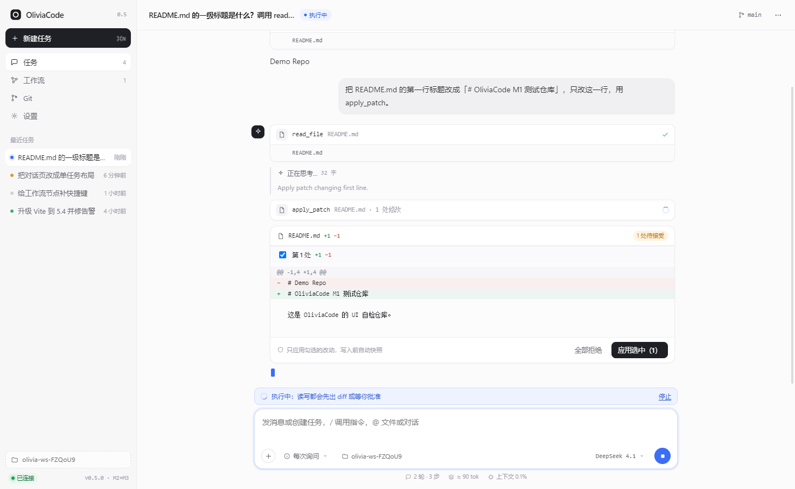
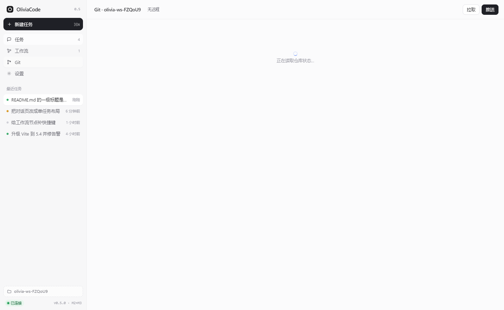
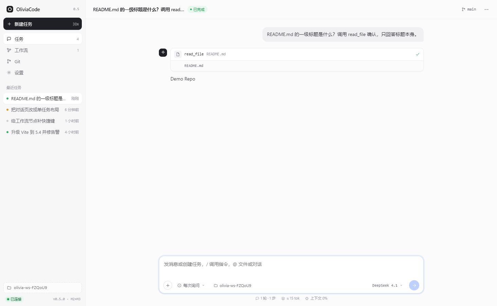
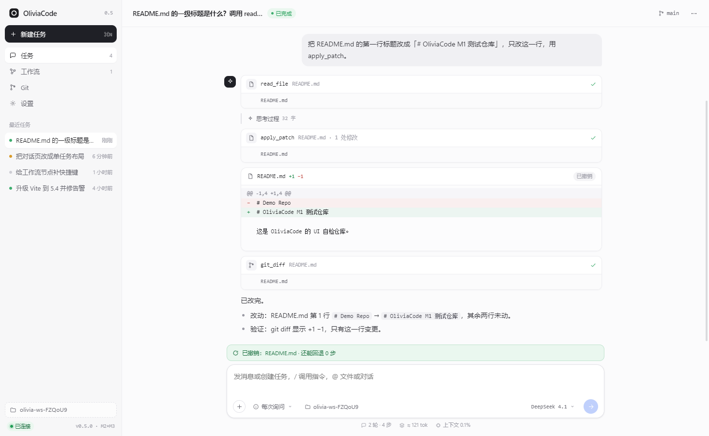

# OliviaCode

本地优先的 AI 编程工作站。外观与交互贴近 Codex，但多了几件它不给的事：**可视化工作流、逐处接受的改动、多步回滚、Git 直连**。

当前是 **M3：Git 与改动的完整闭环**——模型能读你的仓库、改文件、跑命令、提交、推送、开 PR，每一步都可见、可拒、可回滚。

<p align="center">
  
  
</p>

## 能用的东西

- **真实工具调用**：`list_dir`、`read_file`、`search`、`apply_patch`、`write_file`、`run_command`、`git_status`、`git_diff`、`git_commit`、`git_push`、`git_create_pr`。走 OpenAI 原生 `tools` / `tool_calls`。
- **逐处接受**：一次补丁里有几处修改就几个勾选框，可以只应用其中一部分；`old` 不唯一就报错让模型重读，绝不模糊套用。
- **多步回滚**：每次写入前自动快照，卡片上「回滚到这一步之前」，快照带撤销标记，可以一路退回，并提示还能退几步。
- **Git 面板**：克隆或绑定已有仓库、看分支/领先落后、逐 hunk 暂存、提交、分支切换、拉取（ff-only）、推送、创建 PR。
- **一体化输入框**：模型、权限、项目位置、发送/停止都在框内，底部显示轮次、步数、估算 token 与上下文占用。
- **令牌保险箱**：GitHub / GitCode 令牌用 `safeStorage` 加密存在本机，界面只写不读，一键清除；不写进 `.git/config`。
- **审批**：写文件与跑命令默认逐次询问；「始终允许」落进工作区 `.olivia/policy.json`，可提交、可审。
- **主进程隔离**：模型调用、`fs`、命令、令牌都在主进程，渲染层只发意图、收事件。
- **事件日志**：每个任务一份 JSONL，重启后重放消息、工具记录与 diff。

<p align="center">
  
  
</p>

## 快速开始

```bash
npm install          # 首次装 electron 若卡住：ELECTRON_MIRROR=https://npmmirror.com/mirrors/electron/
npm start            # 构建前端 + 主进程，然后启动桌面端
```

其他脚本：

```bash
npm run dev:web        # 只跑前端，浏览器访问 http://127.0.0.1:5273
npm run typecheck      # 前端 + 主进程严格检查
npm run shot           # 截图到 docs/screenshots
```

## 接自己的模型

客户端只认 OpenAI 兼容协议，两种接法：

1. 应用内「设置 → 模型接入」填 Base URL 与 API Key（只存本次会话内存）；
2. 环境变量预置（经 IPC 注入，不落盘）：

```powershell
$env:OLIVIA_BASE_URL='http://127.0.0.1:9088/v1'
$env:OLIVIA_API_KEY='sk-...'
$env:OLIVIA_MODEL='deepseek-v4.1-flash'
$env:OLIVIA_WORKSPACE='D:\your\repo'   # 可选，预置工作区
npm start
```

模型目录与 `GET /models` 对齐：`deepseek-v4.1-flash`、`qwen3.8-27b`。

## Git 令牌

到「设置 → Git 凭据」分别保存 GitHub / GitCode 的访问令牌：

- GitHub：Personal Access Token，勾 `repo` 权限即可。
- GitCode：个人访问令牌，需要仓库写权限。
- 只做推送与 PR，克隆走 HTTPS。

## 自检

```bash
# agent 层：读 → 改 → 撤销 → 跑命令 → 事件日志 → 多步撤销 → 本地 git 闭环（7 条断言）
node apps/desktop/dist/selftest.cjs

# 界面层：无头驱动真实窗口走完「读 → 逐处接受 → 回滚 → Git 页」并截图
electron scripts/ui-e2e.cjs
```

两者都需要 `OLIVIA_BASE_URL` / `OLIVIA_API_KEY`。

## 目录结构

```
apps/
  desktop/          Electron 主进程：agent 循环、工具、快照、事件日志、git、凭据
    src/agent.ts      模型流式 + 工具编排 + 审批 + 逐处接受
    src/git.ts        git CLI 封装、porcelain 解析、hunk 暂存
    src/vault.ts      safeStorage 令牌保险箱
    src/providers.ts  GitHub / GitCode PR
    src/main.ts       IPC、窗口、撤销、git 接口
  web/              React + Vite 渲染层
    src/views/        Chat / Workflow / Git / Settings
    src/components/   Markdown、消息流、工具卡、逐处接受卡、审批条
packages/
  core/             工具契约、事件类型、diff、工作流模型（双端共用）
  exec/             执行器：路径围栏、权限、命令、快照存储
```

## 设计决定

1. **主进程持有能力，渲染层只有视图**：密钥、`fs`、命令、git 都在主进程；渲染层只发意图、收事件。
2. **工具契约化**：工具声明 `name / schema / risk`，界面按 schema 画卡片；加工具＝加一个 case。
3. **改动先看后写**：`apply_patch` 先出逐处预览，用户勾选后才落盘，落盘前快照。
4. **快照独立于 Git**：回滚不与用户的分支、暂存区纠缠；Git 的暂存与提交另走一条路。
5. **令牌不进仓库**：`safeStorage` 加密 + 子进程环境注入，任何日志都脱敏。

## 路线图

| 阶段 | 内容 | 状态 |
| --- | --- | --- |
| M0 | 骨架、Codex 式外壳、工作流画布、真模型直连 | ✅ |
| M1 | 主进程 agent 循环、8 个工具、审批、快照撤销、事件日志 | ✅ |
| M2 | 逐处接受、多步回滚（并入 M3） | ✅ |
| M3 | Git 面板、令牌保险箱、提交/拉推/PR、GitHub + GitCode | ✅ 本次 |
| M4 | 多智能体并行与工作流真实执行 | 下一步 |
| M5 | 定时任务（无人值守，出报告或提 PR） | 计划 |
| M6 | MCP 接入与团队技能 | 计划 |
| M7 | 成本与上下文面板、内置浏览器预览 | 计划 |

## 已知限制

- PR 已在 GitCode 上实跑通过（克隆 → 分支 → 提交 → 推送 → 创建 PR）；GitHub 路径同构但未用真实令牌验证。
- 工作流画布仍是编辑与模拟执行，节点还没真正派发 Agent（M4）。
- 克隆只支持 HTTPS + 令牌，SSH 密钥托管未做。
- 命令以参数数组启动、不经过 shell，管道与重定向需要显式 `cmd /c` 或 `sh -c`。
- 不做 rebase、submodule、LFS，也不提供 force push / `reset --hard`。

## 许可

MIT
