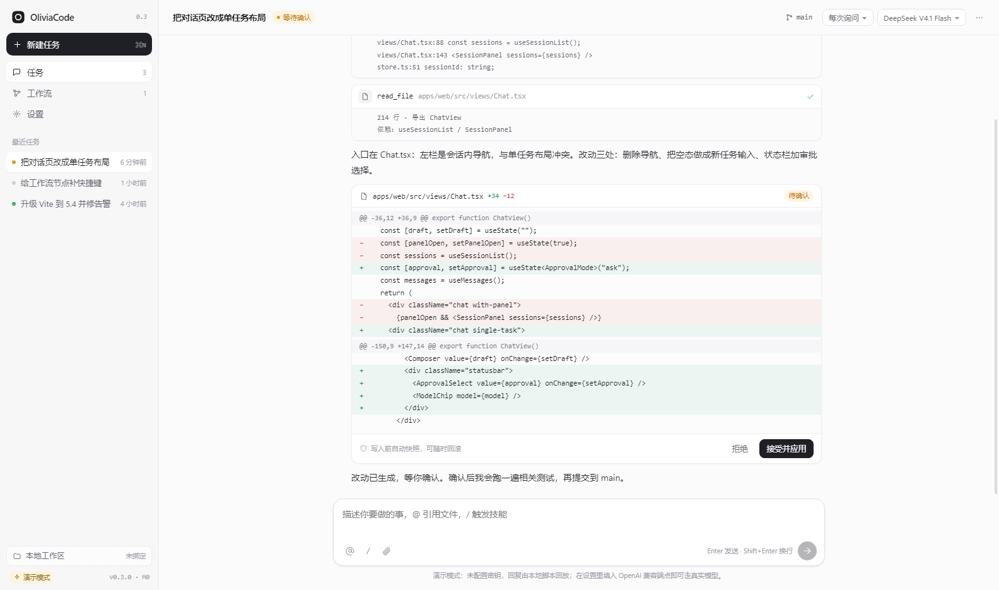
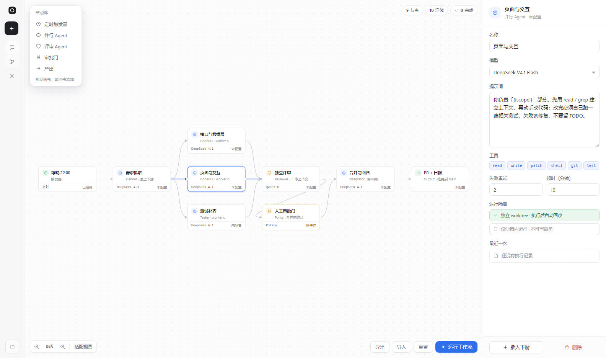
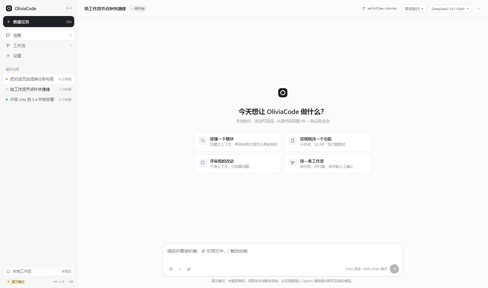
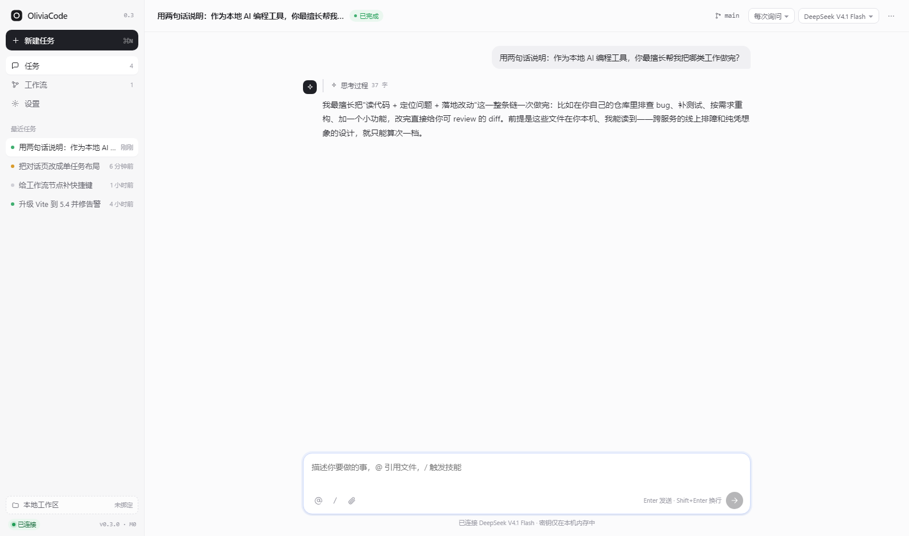

# OliviaCode

本地优先的 AI 编程工作站。外观与交互贴近 Codex，但多了四件它不给的事：**可视化工作流、可回滚执行、Git 直连、定时无人值守**。

当前是 **M0（骨架 + 外壳 + 工作流画布）**。



<p align="center">
  
  
</p>

## M0 里已经能用的东西

- **Codex 式外壳**：左侧任务列表、顶部标题/分支/审批/模型、消息流里的工具调用卡片、内联 diff 卡片与「接受 / 拒绝」。
- **工作流画布**（`#/workflow`）：节点库拖拽或点击添加、节点拖动、从右侧端口拖出连线、滚轮缩放、空白处拖拽平移、适配视图、右侧检查器改模型/提示词/工具/重试/超时/隔离、导出与导入 JSON、重置。
- **模拟执行**：点「运行工作流」按拓扑顺序推进状态，到「人工审批门」停下并变绿为「批准并继续」。
- **真模型直连**：OpenAI 兼容端点，流式输出；`reasoning_content` 会渲染成可折叠的「思考过程」。不配密钥则用本地脚本回放（演示模式）。
- **本地持久化**：任务与工作流草稿存 localStorage，API Key 只留内存、不落盘。



## 接自己的模型

客户端只认 OpenAI 兼容协议，两种接法：

1. 应用内「设置 → 模型接入」填 Base URL 与 API Key（只存本次会话内存）；
2. 开发或自托管时用环境变量预置（经 IPC 注入渲染层，同样不落盘）：

```powershell
$env:OLIVIA_BASE_URL='http://127.0.0.1:9088/v1'
$env:OLIVIA_API_KEY='sk-...'
$env:OLIVIA_MODEL='deepseek-v4.1-flash'
npm start
```

模型目录与 `GET /models` 对齐：`deepseek-v4.1-flash`、`qwen3.8-27b`。换模型只需改 `packages/core/src/types.ts` 的 `MODELS`。

## 快速开始

```bash
npm install          # 首次装 electron 若卡住：ELECTRON_MIRROR=https://npmmirror.com/mirrors/electron/
npm start            # 构建前端 + 启动桌面端
```

其他脚本：

```bash
npm run dev:web      # 只跑前端，浏览器访问 http://127.0.0.1:5273
npm run typecheck    # TypeScript 严格检查
npm run shot         # 用 Electron 截图到 docs/screenshots
```

## 目录结构

```
apps/
  desktop/     Electron 主进程与 preload（窗口、外链拦截、安全策略）
  web/         React + Vite 渲染层
    src/
      views/       Chat / Workflow / Settings
      workflow/    Canvas（自绘节点图）、Inspector、Library
      components/  Sidebar、Composer、MessageList（工具卡、diff 卡）
      store.tsx    任务与设置的 reducer + 本地持久化
      agent.ts     流式回合：真模型直连 / 演示回放
packages/
  core/        事件、任务与工作流模型、布局与拓扑工具（纯函数）
  exec/        执行器骨架：路径围栏、权限策略、命令执行、检索
scripts/       截图脚本
```

## 四个已经定下来的设计决定

1. **事件驱动 UI**：消息与工具调用以事件流推进，UI 只是投影。断线可恢复、可回放、可审计。
2. **工具契约化**：每个工具声明 `name / schema / 风险等级`，UI 不认识具体工具。加工具＝加文件，不改界面。
3. **权限三层**：`只读 / 工作区可写 / 全部放行`，由执行器强制，UI 绕不过去。
4. **快照独立于 Git**：写入前对受影响文件做内容寻址快照，撤销就是还原，不污染用户的仓库。

## 路线图

| 阶段 | 内容 | 状态 |
| --- | --- | --- |
| M0 | 骨架、Codex 式外壳、工作流画布、真模型直连 | ✅ 本次 |
| M1 | 本地网关 + 工具调用闭环（读/写/跑命令）+ 事件日志落盘 | 下一步 |
| M2 | 快照与一键回滚、逐 hunk 接受 | 计划 |
| M3 | Git 可视化：绑定本地仓库、远程 + 令牌、克隆/拉/推/PR | 计划 |
| M4 | 多智能体并行与工作流真实执行 | 计划 |
| M5 | 定时任务（无人值守，出报告或提 PR） | 计划 |
| M6 | MCP 接入与团队技能 | 计划 |
| M7 | 成本与上下文面板、内置浏览器预览 | 计划 |

## 已知限制

- 工作流执行目前是前端模拟，尚未真正派发 Agent（M4）。
- 执行器 `packages/exec` 已具备路径围栏与策略骨架，但还没接到 UI（M1）。
- 演示模式的回复是脚本，不代表模型能力。

## 许可

MIT
